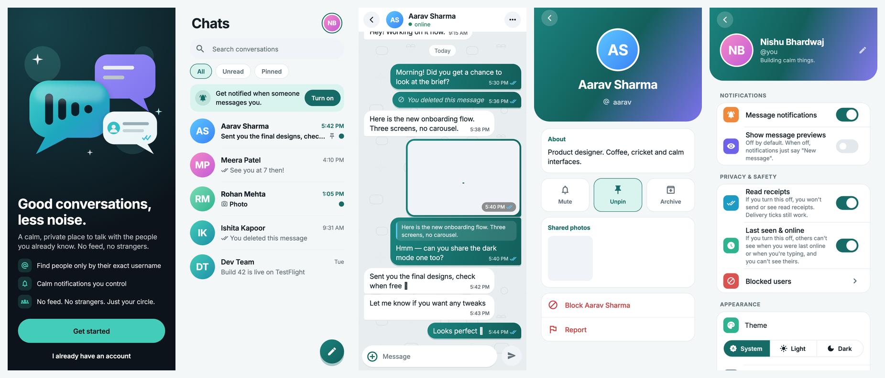
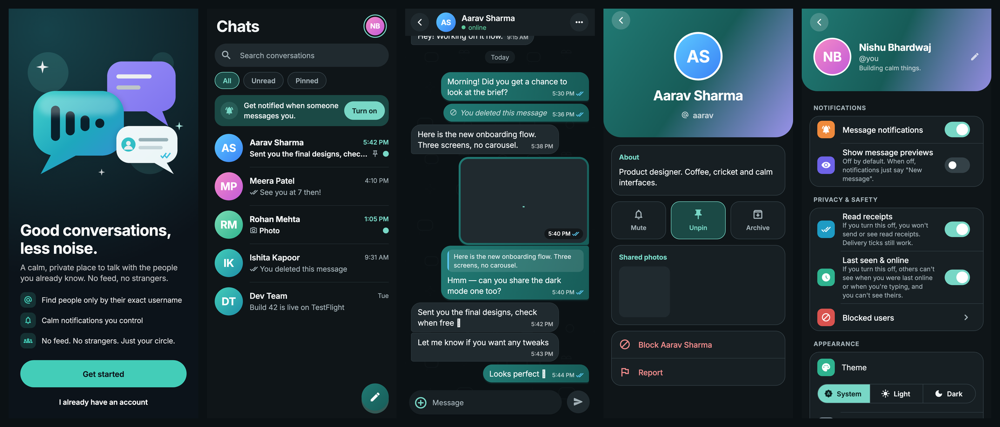

<div align="center">


# Hushlo

**Good conversations, less noise.**

A calm, private chat app for the people you already know — no feed, no strangers, no contact-book upload.
Built with Flutter (Android + iOS) and Firebase.


</div>

> **Name notice:** "Hushlo" is a working codename and has **not** been trademark-cleared. Check app stores,
> domains and trademark registries before using it publicly.
>
> **Not end-to-end encrypted.** Messages are encrypted in transit and protected by Firestore/Storage access
> rules, but they are stored in the cloud and are **not** end-to-end encrypted. The app says so in its UI.

---

## Screenshots

<sub>Rendered by the in-repo design harness (`tool/screenshots/`) with sample data — light and dark.</sub>

| Light |
|---|
|  |

| Dark |
|---|
|  |

*Left to right: intro · chats · conversation · contact info · settings.*

---

## Features

**Accounts & discovery**
- Email/password sign-up with email verification and password reset; Google sign-in (Sign in with Apple is built and opt-in).
- Unique usernames reserved transactionally (race-safe). People are found **only by exact username** — there is no user directory.
- Optional avatar and short bio; invite a friend with a share sheet.

**Messaging**
- Real-time one-to-one chat with bounded live window + cursor pagination (no unbounded history reads).
- Optimistic sending with idempotent message IDs, offline queue, retry/remove for failed sends.
- **WhatsApp-style ticks:** ✓ sent · ✓✓ delivered · blue ✓✓ read (respects a "Read receipts" privacy switch).
- **Typing indicator** and **online / last seen** (shared "Last seen & online" privacy switch).
- Reply (swipe, or tap the quote to jump to the original), emoji reactions (tap again to remove),
  copy, multi-select, **delete for me**, **delete for everyone** (sender, 48 h), **clear chat**.
- Photos: gallery/camera, client-side compression + thumbnail, real upload progress, cancel/retry, full-screen viewer.
- Day separators, grouped bubbles, scroll position preserved while reading, "new messages" pill.

**Inbox & control**
- Pin, mute, archive, search, All/Unread/Pinned filters; last message, time, unread dot and live "typing…" per row.
- Block and report (reports are write-only for clients; only a moderator process can read them).
- Notification permission asked in context; previews off by default (notifications say "New message").

**Trust & compliance**
- In-app account deletion (with re-auth and an anonymous "why are you leaving" reason) plus a public deletion page (`public_web/`).
- Privacy policy / terms / community guidelines **drafts** bundled in-app (`assets/legal`) — they need legal review before release.
- Strict deny-by-default Firestore and Storage security rules, covered by emulator tests.

**Design**
- Material 3 with centralised design tokens, Inter typeface, gradient avatars, generated illustrations, light/dark/system themes,
  reduced-motion support, large-text support, 48 dp tap targets, semantic labels on icon-only controls.

### Not in v1 (by design)
Voice/video calls, group chats, stories/feeds, public channels, bots, payments, contact-book discovery, E2EE, web/desktop.

---

## Tech stack

| Area | Choice |
|---|---|
| App | Flutter 3.29.3 / Dart 3.7.2, Material 3 |
| State | `flutter_riverpod` 3 (Notifier view-models), no service locator |
| Navigation | `go_router` 17 (auth/verification/profile guards, notification deep links) |
| Backend (managed) | Firebase Auth, Cloud Firestore, Cloud Storage, FCM, App Check, Cloud Functions (Node 20, TypeScript) |
| Plugins pinned for Flutter 3.29 | `firebase_core 3.x`, `firebase_auth 5.x`, `cloud_firestore 5.x`, `firebase_storage 12.x`, `firebase_messaging 15.x`, `firebase_app_check 0.3.x`, `cloud_functions 5.x` |
| Other | `google_sign_in 7`, `flutter_local_notifications`, `cached_network_image`, `image_picker`, `flutter_image_compress`, `connectivity_plus`, `share_plus` |
| Tests | `flutter_test`, `mocktail`, Firebase Emulator Suite + `@firebase/rules-unit-testing`, `vitest` |

> Firebase plugin versions are intentionally pinned to the releases compatible with Flutter 3.29. Newer plugin
> majors need a newer Flutter (they reference iOS APIs introduced in later Flutter versions).

---

## Architecture

Feature-first clean architecture with unidirectional data flow. **UI never talks to Firebase directly.**

```
Widget ──event──▶ ViewModel (Riverpod Notifier) ──▶ UseCase (when policy is involved)
   ▲                                                      │
   │ immutable state                                      ▼
   └─────────────────────────── Repository interface ◀── Firebase service (data layer)
                                                            │
                                         Firestore · Auth · Storage · FCM · Functions
```

```
lib/
├── main.dart · bootstrap.dart · app.dart · firebase_options.dart (generated)
├── core/            config, errors (typed Failures), theme tokens, router, l10n, shared widgets, utils
├── l10n/            app_en.arb (+ generated AppL10n)
└── features/
    ├── auth/ · onboarding/ · profile/ · user_search/
    ├── conversations/   inbox, member prefs (pin/mute/archive/clear)
    ├── chat/            timeline, bubbles, composer, receipts, typing, reactions
    ├── attachments/     picker → compress → upload → message
    ├── notifications/   FCM tokens, foreground/tap routing
    ├── presence/        online / last seen
    ├── privacy_settings/ · safety/ (block, report) · account_deletion/
    └── <feature>/{data,domain,presentation}
functions/           Cloud Functions + Firestore/Storage rules tests
public_web/          static privacy / terms / account-deletion pages (Firebase Hosting)
tool/screenshots/    design-review screenshot harness
```

Key decisions: typed `Failure`s mapped to localized copy (raw Firebase errors are never shown); Firestore's local
cache *is* the optimistic layer (`hasPendingWrites` drives the "sending" state); deterministic direct-chat IDs
(`uidA_uidB`, sorted) so a pair can never get two chats.

---

## Getting started

### Prerequisites
- Flutter **3.29.x** (`flutter --version`) and the Android SDK / Xcode (iOS builds need macOS)
- Node.js 20 and the [Firebase CLI](https://firebase.google.com/docs/cli) (`npm i -g firebase-tools`)
- FlutterFire CLI: `dart pub global activate flutterfire_cli`
- A Firebase project (a separate project for dev and prod is recommended)

### 1. Clone and install
```bash
git clone <your-repo-url> hushlo && cd hushlo
flutter pub get
```

### 2. Choose your app IDs
The project ships with the placeholder ID **`com.example.hushlo`**, which cannot be published. Pick a reverse-domain ID
and change it in `android/app/build.gradle.kts` (`namespace`, `applicationId`), the Kotlin package of `MainActivity`,
and Xcode (Runner → Bundle Identifier). Use the **same** ID for Firebase below.

### 3. Create the Firebase project
In the [Firebase console](https://console.firebase.google.com/):
1. **Authentication** → enable **Email/Password** (and **Google** if you want it).
2. **Firestore Database** → create → **Standard edition**, database `(default)`, **production mode**, pick a region and note it.
3. **Storage** → enable (needed for photos/avatars; may require the Blaze plan).
4. **Blaze plan** + a budget alert — required for Cloud Functions (push, account deletion, orphan cleanup).

### 4. Link the app to your project
```bash
firebase login
flutterfire configure --project=<PROJECT_ID> --platforms=android,ios \
  --android-package-name=<APP_ID> --ios-bundle-id=<APP_ID> --yes
```
This generates the files that are **git-ignored on purpose** (they contain per-project API keys that GitHub's secret
scanner flags): `lib/firebase_options.dart`, `android/app/google-services.json`,
`ios/Runner/GoogleService-Info.plist`. **A fresh clone does not compile until they exist**, so run this step first.

> Just want to see the UI shell without Firebase? `cp lib/firebase_options.dart.template lib/firebase_options.dart`
> — the app then shows a "Firebase is not configured" screen. (Android additionally needs a `google-services.json`,
> so use `flutterfire configure` for a real build.)

Then point the repo at your project and deploy the rules/indexes:
```bash
echo '{"projects":{"default":"<PROJECT_ID>"}}' > .firebaserc
firebase deploy --only firestore:rules,firestore:indexes   # add ",storage" once Storage is enabled
```
Wait for the indexes to finish building (Console → Firestore → Indexes) before testing the chat list.

### 5. Run
```bash
flutter run
```

### Google sign-in setup
1. Console → Authentication → Sign-in method → **Google** → Enable.
2. **Android:** add your SHA-1 and SHA-256 (`keytool -list -v -alias androiddebugkey -keystore ~/.android/debug.keystore -storepass android`)
   under Project settings → your Android app, then re-run `flutterfire configure`.
3. **iOS:** after re-running `flutterfire configure`, copy `REVERSED_CLIENT_ID` from `GoogleService-Info.plist` into the
   `CFBundleURLSchemes` entry of `ios/Runner/Info.plist`.
4. Set `GOOGLE_SERVER_CLIENT_ID` (Web client ID from the Google provider settings) — see flags below.
5. Sign in with Apple (`--dart-define=APPLE_SIGN_IN=true`) needs a paid Apple Developer account and the capability;
   Apple requires it before App Store release whenever Google sign-in is offered.

### Build-time flags (`--dart-define`)
| Flag | Default | Purpose |
|---|---|---|
| `SOCIAL_SIGN_IN` | `true` | Show "Continue with Google" |
| `APPLE_SIGN_IN` | `false` | Show "Continue with Apple" (iOS) |
| `GOOGLE_SERVER_CLIENT_ID` | this project's Web client ID | **Override with your own** Web client ID |
| `SUPPORT_EMAIL` | *(hidden)* | Shows a Support row in Settings |
| `WEB_BASE_URL` | *(none)* | Base URL of the hosted legal/deletion pages |
| `FUNCTIONS_REGION` | `us-central1` | Must match the deployed Functions region |
| `USE_EMULATOR` / `EMULATOR_HOST` | `false` / `localhost` | Run against the Firebase Emulator Suite |

---

## Backend

| Piece | Location | Notes |
|---|---|---|
| Firestore rules | `firestore.rules` | Deny-by-default; schema validated per collection |
| Storage rules | `storage.rules` | Membership, ownership, content-type and size checks |
| Indexes | `firestore.indexes.json` | Inbox query + media cleanup |
| Cloud Functions | `functions/src` | `onMessageCreated` (summary + push), `deleteUserAccount`, `cleanupOrphanedMedia` |
| Static pages | `public_web/` | Privacy / terms / **account-deletion** pages for store listings |

```bash
cd functions && npm install && npm run build
firebase deploy --only functions          # needs the Blaze plan
firebase deploy --only hosting            # publishes public_web/
```
Set the Functions region to match Firestore (see `functions/README.md`). Account-deletion policy, push payload rules and
the Sign in with Apple token-revocation TODO are documented there.

**Without Functions:** text chat, search, receipts, typing, presence and the inbox still work (the inbox reads the latest
message directly). Push notifications, account deletion and orphan cleanup need Functions.

### Data model (summary)
| Path | Purpose |
|---|---|
| `publicProfiles/{uid}` · `usernameIndex/{name}` | Public profile; exact-lookup username reservation |
| `users/{uid}/private/settings` · `users/{uid}/devices/{id}` · `users/{uid}/blocks/{uid}` | Owner-only settings, FCM tokens, blocks |
| `presence/{uid}` | `lastActiveAt` heartbeat (readable by people you share a chat with) |
| `conversations/{uid_uid}` | Members + server-maintained summary |
| `…/members/{uid}` · `…/receipts/{uid}` · `…/typing/{uid}` | Per-user prefs (pin/mute/archive/cleared), delivery/read receipts, typing signal |
| `…/messages/{id}` (+ `reactions/{uid}`) | Immutable messages (only the sender may wipe content within 48 h) |
| `reports/{id}` · `deletionFeedback/{id}` | Write-only for clients |

---

## Testing

```bash
flutter analyze
flutter test                                   # unit + widget tests (view-models, validators, receipts, bubbles, screens)

cd functions
npm install
npm test                                       # Firestore/Storage rules (emulator) + Cloud Function unit tests

# Design-review screenshots (all screens, light + dark, no Firebase needed)
SHOT_DIR=/tmp/shots flutter test tool/screenshots/screens_test.dart
```

What is **not** covered by automation: real-device push delivery, APNs, multi-device ticks/typing end-to-end,
and the Cloud Functions running in an emulator. Test those manually on two real devices before release.

---

## Release builds

```bash
flutter build apk --release
flutter build appbundle --release
flutter build ipa --release          # macOS + Xcode + signing required
```
- Create an Android upload key and a `key.properties` (both git-ignored); configure signing in `android/app/build.gradle.kts`
  (the template falls back to the debug key, which is **not** acceptable for the Play Store).
- iOS: set your Team/bundle ID, enable **Push Notifications**, upload an APNs `.p8` key to Firebase → Cloud Messaging.
- Toolchain used: AGP 8.9.1 · Gradle 8.11.1 · Kotlin 2.2.20 · compileSdk 36 · minSdk 23 · iOS 15.0.
- Before store submission: real privacy policy + Data safety / App Privacy answers, a working account-deletion URL
  (`public_web/delete-account.html`), real screenshots, and a trademark check on the name.

---

## Security & privacy notes
- No secrets in the repo: signing keys, `.p8`, service accounts and `.env*` are git-ignored. **Never commit them.**
- Client Firebase config is not a secret, but restrict your API keys in Google Cloud Console and enable **App Check**
  (Play Integrity / App Attest) before enforcing it.
- Rules are the security boundary — keep the emulator tests green when changing them.
- Logs never contain message text, emails, tokens or media URLs.
- Presence/typing/read receipts are reciprocal: turning them off hides yours **and** theirs from you.
- Online status is an approximate heartbeat (~1/min while the app is foregrounded); delivery ticks are recorded while the
  recipient's app is running.

## Cost drivers
Firestore reads/listeners (inbox rows listen to a latest-message, receipts and typing doc each), Storage + egress for
photos, Cloud Functions invocations, and FCM. Queries are bounded and images are compressed; set a Firebase budget alert.

---

## Contributing
1. Fork and create a feature branch.
2. `flutter analyze` and `flutter test` must pass; run `npm test` in `functions/` if you touch rules or functions.
3. Keep Firebase calls inside `data/` layers, add strings to `lib/l10n/app_en.arb`, and add tests for new logic.
4. Open a pull request describing the change and how you tested it.

## License
No license has been chosen yet. Until one is added (for example MIT or Apache-2.0 in a `LICENSE` file), all rights are
reserved by the author(s).

## Credits
- Typeface: [Inter](https://rsms.me/inter/) (SIL Open Font License 1.1, see `assets/fonts/Inter-LICENSE.txt`).
- App icon, illustrations and UI are original artwork generated for this project.
